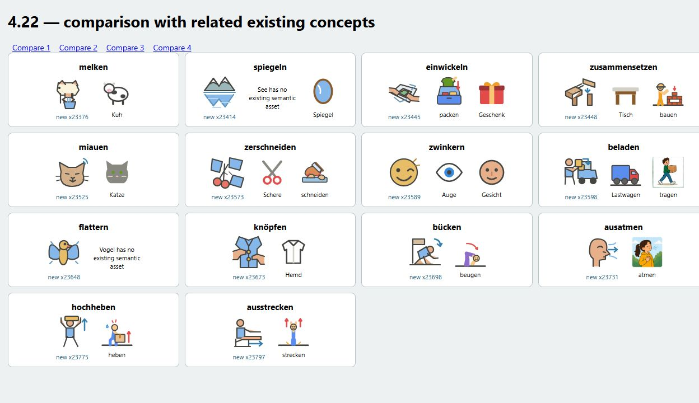
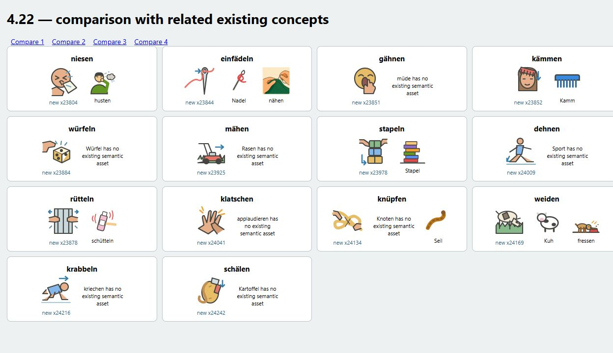
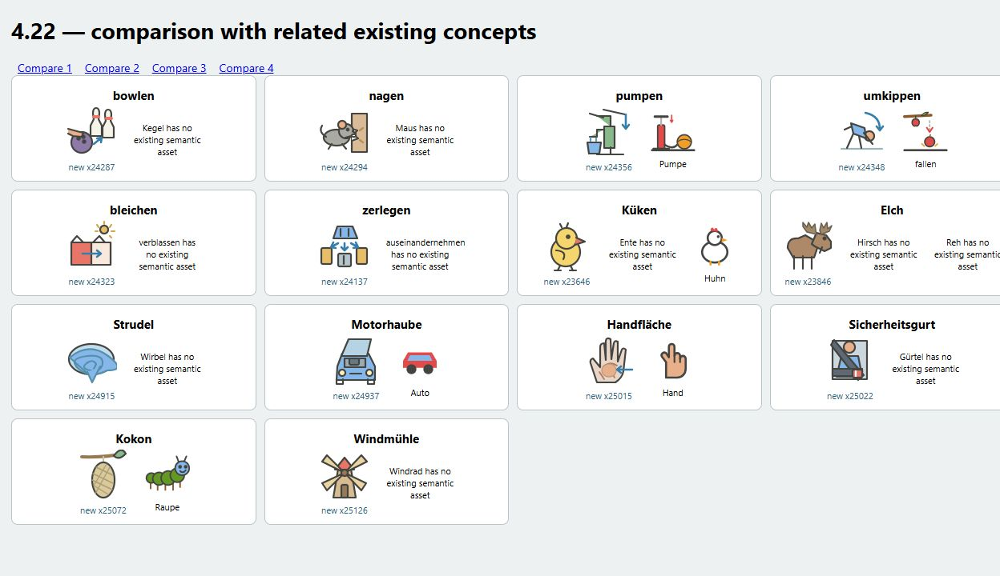
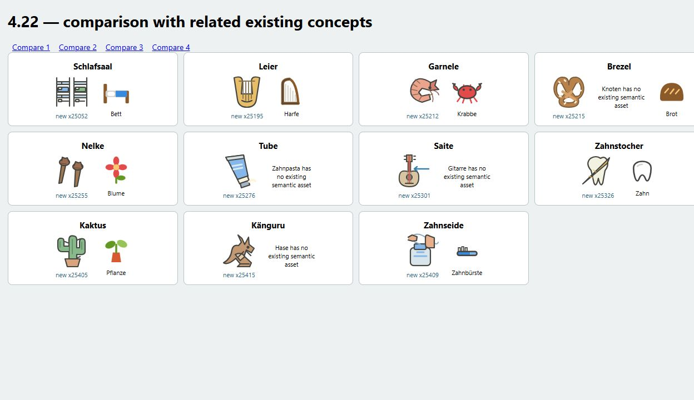
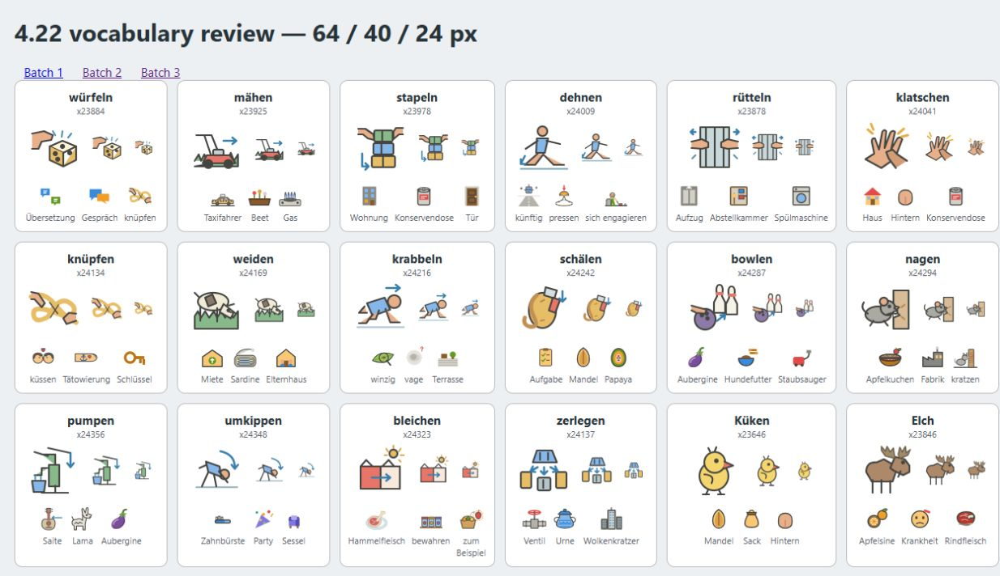
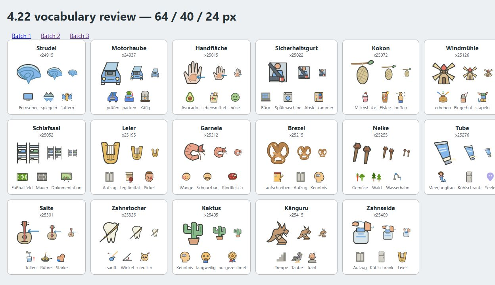

# Visual review for 4.22

62 C1 candidates were reviewed individually: **53 drawings ship (34 verbs and
19 nouns)** and nine are declined with per-card reasons. This completes this
batch; it does not claim that the remaining C1/C2 deck has been exhausted.

Each candidate was checked against its exact card sense, example and stable ID.
None shadows the higher-priority generated scene map. All shipped files are
text-free, pure vectors with a `0 0 64 64` view box. XML was checked, and every
draft was inspected in a browser at 64, 40 and 24 pixels, beside ranked visual
neighbours. A second browser pass compared all accepted cues with semantically
related existing drawings or generated scenes. The numeric ranking used resvg
2.6.2 at 24 pixels; it is a review aid, not a semantic similarity test.

The moose, pretzel, palm, guitar string and dormitory drafts were refined during
review. The spinach draft failed its small-size semantic review and was removed.
The four comparison sheets below are captured from the final browser review.

## Accepted cues

| Card | Word | Reviewed cue |
|---|---|---|
| x23376 | melken | Hands milking an udder into a bucket; distinct from the cow alone. |
| x23414 | spiegeln | Mountains and their inverted reflection in water, following the card's example. |
| x23445 | einwickeln | Two hands folding a translucent wrapper around food, rather than a gift box. |
| x23448 | zusammensetzen | Furniture parts brought together with an insertion arrow. |
| x23525 | miauen | Cat with an open mouth and sound strokes, compared with the closed-mouth cat cue. |
| x23573 | zerschneiden | Scissors and several separated fabric pieces, compared with cutting food. |
| x23589 | zwinkern | One open eye and one closed eye, rather than a generic smiling face. |
| x23598 | beladen | Person putting a box onto a truck, compared with a truck and carrying alone. |
| x23648 | flattern | A bird with extended wings and wing-motion strokes. |
| x23673 | knöpfen | Hands at the buttons of a shirt, compared with an unbuttoned clothing outline. |
| x23698 | bücken | Person stooping beneath a low doorway, rather than standing or kneeling alone. |
| x23731 | ausatmen | Profile with a directional outward breath arrow; distinct from the general breathing scene. |
| x23775 | hochheben | Person lifting a box overhead with an upward arrow. |
| x23797 | ausstrecken | Seated person extending the legs forward, compared with stretching arms upward. |
| x23804 | niesen | Closed eyes, tissue and outward sneeze strokes; compared with the coughing cue. |
| x23844 | einfädeln | Thread passing through the eye of a needle, compared with a needle and sewing. |
| x23851 | gähnen | Wide open mouth, closed eyes and a covering hand. |
| x23852 | kämmen | Comb against a person's hair with a downward motion arrow. |
| x23884 | würfeln | A releasing hand, moving die and three-dimensional pips. |
| x23925 | mähen | Lawnmower crossing grass; the mower and cut strip identify the action. |
| x23978 | stapeln | Hands arranging a vertical stack of boxes, compared with an existing static stack. |
| x24009 | dehnen | Person in a stretching lunge, following the pre-exercise example. |
| x23878 | rütteln | Hands gripping bars with lateral motion marks, compared with shaking a bottle. |
| x24041 | klatschen | Overlapping hands with impact strokes, rather than a single raised hand. |
| x24134 | knüpfen | Two hands tightening a rope knot, compared with a plain rope. |
| x24169 | weiden | Cow with its head down in grass, compared with a cow and an eating pet. |
| x24216 | krabbeln | Small person on hands and knees with a forward motion arrow. |
| x24242 | schälen | Peeler and a curling strip of potato skin. |
| x24287 | bowlen | Released bowling ball approaching upright pins. |
| x24294 | nagen | Rodent's incisors at a notched surface with small bite marks. |
| x24356 | pumpen | Working hand pump delivering water into a bucket, following the plumbing example. |
| x24348 | umkippen | Person tipping forward with a curved downward motion arrow. |
| x24323 | bleichen | Cloth transitioning from a strong colour to a pale colour under sunlight. |
| x24137 | zerlegen | An exploded object with components moving apart, rather than an intact machine. |
| x23646 | Küken | Large-headed yellow chick with a small wing and crest; compared with the adult chicken. |
| x23846 | Elch | Heavy muzzle, shoulder hump and broad palmate antlers. The first draft's thin antlers were revised. |
| x24915 | Strudel | Water spiralling into a funnel; this card means a whirlpool, not pastry. |
| x24937 | Motorhaube | Car with its hood raised above a visible engine compartment. |
| x25015 | Handfläche | Open palm with crease detail, a highlighted central area and a part pointer. |
| x25022 | Sicherheitsgurt | Seated occupant with a diagonal and lap belt and a visible buckle. |
| x25072 | Kokon | Silk-like casing suspended from a twig, compared with a caterpillar. |
| x25126 | Windmühle | Traditional mill tower with four sails; distinct from a turbine silhouette. |
| x25052 | Schlafsaal | Two sets of bunk beds with pillows and mattresses, compared with a single bed. |
| x25195 | Leier | U-shaped yoke and parallel strings, compared with the triangular harp cue. |
| x25212 | Garnele | Curved segmented shrimp with tail fan and antennae, compared with a crab. |
| x25215 | Brezel | Knotted baked form with three openings and salt marks. The first draft's loops were revised. |
| x25255 | Nelke | Two dried clove buds; the example specifies the spice, not the flower. |
| x25276 | Tube | Crimped soft tube with shoulder and screw cap; the card means the container. |
| x25301 | Saite | Highlighted string and a pointer on an instrument, replacing a weak neck-only draft. |
| x25326 | Zahnstocher | Pointed wooden pick beside a tooth; compared with the tooth alone. |
| x25405 | Kaktus | Ribbed cactus with spines and side arms, compared with a leafy plant. |
| x25415 | Känguru | Long tail, large hind feet, upright ears and a pouch. |
| x25409 | Zahnseide | Floss dispenser with a thread held between two fingers, compared with a toothbrush. |

## Declined candidates

| Card | Word | Reason |
|---|---|---|
| x24038 | dämpfen | The example means curbing appetite. A steaming pot would illustrate a different sense; no neutral single cue identifies the intended reduction. |
| x24912 | Spinat | Rendered leaf cluster did not distinguish spinach from generic leaves or other greens at 24 pixels; the draft was removed. |
| x24849 | Schlips | The existing Krawatte cue already depicts a necktie. A second tie silhouette adds no useful distinction. |
| x24878 | Hochhaus | The existing Wolkenkratzer cue already depicts a tall multi-storey building; another outline would not distinguish these overlapping senses. |
| x24999 | Lehm | An unlabelled brown lump does not distinguish clay from soil, mud or modelling material. |
| x25009 | Marmor | A small stone or veined block does not reliably identify marble rather than another stone material. |
| x24918 | Namensschild | The identifying feature is a written name; a text-free badge would also read as an ID or label. |
| x25078 | Mietwagen | Rental status is contractual, not a visible property of a car. |
| x25198 | Küchenchef | The executive role cannot be distinguished from an ordinary cook by a generic hat and apron. |

## Content corrections found during review

The reviewed forms now include **die Küken**, **die Strudel**, **die Zahnstocher**
and **die Kakteen**, where the deck previously marked no plural. Küken also loses
an overlong gloss with an unmatched bracket. These forms were checked against
[Duden: Küken](https://www.duden.de/rechtschreibung/Kueken_Kind_Jungtier),
[Strudel](https://www.duden.de/rechtschreibung/Strudel),
[Zahnstocher](https://www.duden.de/rechtschreibung/Zahnstocher) and
[Kaktus](https://www.duden.de/rechtschreibung/Kaktus).

The dämpfen gloss now includes the reduction sense used in its example, alongside
steaming. Leier is described as a lyre, removing the incorrect lute parenthesis.
Checked against [Duden: dämpfen](https://www.duden.de/rechtschreibung/daempfen) and
[Leier](https://www.duden.de/rechtschreibung/Leier). The less familiar plural
Zahnseiden was checked and retained; see [Duden: Zahnseide](https://www.duden.de/rechtschreibung/Zahnseide).

## Coverage after the batch

2,391 authored SVGs (23.91% of 10,000 cards), 52 generated-scene lemmas, 85 line
pictograms and 187 emoji mappings. These tiers overlap and must not be added to
claim a total semantic-coverage percentage. Emoji mappings were regenerated after
the SVG review. These are reviewed memory cues, not learner-tested definitions.

Final 64/40/24-pixel checks after refinement:

